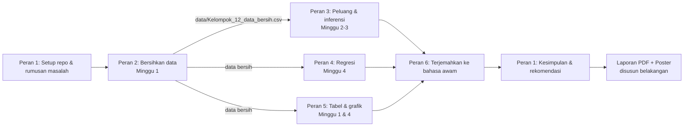

# Proyek Statistika & Probabilitas — Kelompok 12
### Tema B: Kualitas Udara & Mobilitas Perkotaan

> Dataset: `data/Kelompok_12_Tema_B_Kualitas_Udara.csv` (350 observasi, 9 kolom).
> Alat kerja: **Google Colab** (bareng-bareng, tanpa install apa pun) + **GitHub** (tempat menyimpan & menggabungkan hasil).

Repo ini adalah **"papan kerja"** untuk 6 orang. Semua sudah disiapkan: aturan dosen sudah dirangkum, tugas dibagi per peran, dan tiap peran punya **panduan langkah demi langkah + notebook Colab siap jalan**. Luaran **Laporan PDF** dan **Poster** akan disusun belakangan (folder `reports/` dan `poster/` sudah disiapkan).

---

## 🎯 Pertanyaan riset (dari panduan dosen, Tema B)

| # | Metode | Pertanyaan |
|---|---|---|
| 1 | Uji-t | Apakah rata-rata `Indeks_PM25` berbeda signifikan antara **Hari Kerja** dan **Akhir Pekan**? |
| 2 | ANOVA | Apakah rata-rata `Indeks_PM25` berbeda di ketiga **Zona_Lokasi**? |
| 3 | Chi-Square & Peluang | Apakah `Status_Udara` berkaitan dengan `Jam_Sibuk`? Hitung P(Tidak Sehat \| Jam Sibuk). |
| 4 | Regresi | Bagaimana pengaruh `Volume_Kendaraan` dan `Kecepatan_Angin_KmJ` terhadap `Indeks_PM25`? |

---

## 👥 Pembagian peran

Satu orang = satu peran utama. Baca file panduan peranmu **dulu**, baru buka notebook.

| Peran | Tugas inti | Panduan | Notebook | Beban terberat |
|---|---|---|---|---|
| 1. **Project Lead** | Rumusan masalah, koordinasi, kesimpulan strategis & rekomendasi | [PERAN_1](docs/peran/PERAN_1_Project_Lead.md) | — (dokumen di `reports/draft/`) | Minggu 1 & 4 |
| 2. **Data Engineer** | Skala ukur, missing values, outlier, **data bersih resmi** | [PERAN_2](docs/peran/PERAN_2_Data_Engineer.md) | `01_Data_Engineer` | Minggu 1 |
| 3. **Probability & Inference Analyst** | Peluang, Normal, Binomial, CI, t-test, ANOVA, Chi-Square | [PERAN_3](docs/peran/PERAN_3_Probability_Inference_Analyst.md) | `02a_...` dan `02b_...` | Minggu 2 & 3 |
| 4. **Regression & Modeling Analyst** | Korelasi, regresi berganda, uji asumsi residual | [PERAN_4](docs/peran/PERAN_4_Regression_Modeling_Analyst.md) | `03_Regression_Modeling` | Minggu 4 |
| 5. **Data Visualizer & Editor** | Tabel deskriptif, grafik, tata letak laporan & poster | [PERAN_5](docs/peran/PERAN_5_Data_Visualizer_Editor.md) | `04_Data_Visualizer` | Minggu 1 & 4 |
| 6. **Technical Writer & Presentation Lead** | Menerjemahkan hasil jadi bahasa awam & rekomendasi bisnis/kebijakan, naskah presentasi | [PERAN_6](docs/peran/PERAN_6_Technical_Writer_Presentation_Lead.md) | — (dokumen di `reports/draft/`) | Minggu 2–4 |

> **Analogi proyek distro Linux:** Project Lead = *maintainer* yang memutuskan arah & menggabungkan kerja; setiap peran = *pemilik modul* (satu modul, satu pemilik, supaya tidak tabrakan); sistem **saling periksa** (buddy check) = *code review*; GitHub = *repository* tempat semua digabung.
> **Catatan:** proyek ini bukan melatih model AI "ajaib". Regresi linear (Peran 4) adalah bentuk paling dasar dari *machine learning*: model belajar pola dari data lalu dipakai memprediksi. Fondasi statistik yang kalian pelajari di sini dipakai di semua model AI.

---

## 🚀 Mulai cepat (urutan wajib)

**Dikerjakan Project Lead (sekali saja, ±15 menit):**
1. Buat akun GitHub (kalau belum) → buat repository baru, **disarankan *Private*** (alasan: dataset & hasil analisis jangan bisa disalin kelompok lain — dosen memberi nilai 0 jika memakai dataset kelompok lain).
2. Unzip file ini, lalu **upload semua isinya** ke repository (lihat [panduan GitHub & Colab](docs/02_panduan_github_colab.md), Bagian 1).
3. Ganti tulisan `USERNAME` dan `NAMA-REPO` dengan milik kalian (Bagian 2 panduan; ada 2 cara mudah).
4. Undang 5 anggota lain: *Settings → Collaborators → Add people*.

**Dikerjakan semua anggota:**
5. Baca [`docs/01_ketentuan_ringkas.md`](docs/01_ketentuan_ringkas.md) (5 menit) lalu panduan **peranmu**.
6. Buka & jalankan `00_Kenalan_Dengan_Data` di Colab (tombol di bawah) untuk memastikan semuanya jalan.
7. Kerjakan notebook peranmu, ikuti jadwal di [`docs/03_jadwal_dan_alur_kerja.md`](docs/03_jadwal_dan_alur_kerja.md).

### Buka notebook di Colab
> Setelah `Tur-ai/udara-mobilitas-statsprob` diganti, klik tombolnya. Kalau repo *Private*, Colab akan meminta kamu mengizinkan akses GitHub.

| Notebook | Pemilik | Buka |
|---|---|---|
| 00 Kenalan dengan data | semua | [](https://colab.research.google.com/github/Tur-ai/udara-mobilitas-statsprob/blob/main/notebooks/00_Kenalan_Dengan_Data.ipynb) |
| 01 Data Engineer | Peran 2 | [](https://colab.research.google.com/github/Tur-ai/udara-mobilitas-statsprob/blob/main/notebooks/01_Data_Engineer.ipynb) |
| 02a Peluang & distribusi | Peran 3 | [](https://colab.research.google.com/github/Tur-ai/udara-mobilitas-statsprob/blob/main/notebooks/02a_Probability_Peluang_Distribusi.ipynb) |
| 02b Inferensi & uji hipotesis | Peran 3 | [](https://colab.research.google.com/github/Tur-ai/udara-mobilitas-statsprob/blob/main/notebooks/02b_Inference_Uji_Hipotesis.ipynb) |
| 03 Regresi | Peran 4 | [](https://colab.research.google.com/github/Tur-ai/udara-mobilitas-statsprob/blob/main/notebooks/03_Regression_Modeling.ipynb) |
| 04 Visualisasi | Peran 5 | [](https://colab.research.google.com/github/Tur-ai/udara-mobilitas-statsprob/blob/main/notebooks/04_Data_Visualizer.ipynb) |

---

## 🗺️ Alur kerja & ketergantungan



**Titik kritis:** semua orang menunggu **data bersih resmi** dari Peran 2. Sampai itu ada, notebook memakai *DRAF SEMENTARA* (cukup untuk latihan, bukan untuk hasil final). Peran 2 sebaiknya selesai dalam **3–4 hari pertama**.

---

## 📁 Struktur repo

```
├── README.md                     ← kamu di sini
├── setup_repo.py                 ← (opsional) skrip ganti Tur-ai/udara-mobilitas-statsprob sekaligus
├── data/
│   ├── Kelompok_12_Tema_B_Kualitas_Udara.csv   ← data asli (JANGAN DIUBAH)
│   ├── Kelompok_12_data_bersih.csv             ← akan dibuat Peran 2
│   └── README.md                 ← kamus data
├── notebooks/                    ← 6 notebook Colab (1 notebook = 1 pemilik)
├── src/helpers.py                ← fungsi bantu bersama
├── outputs/
│   ├── figures/                  ← semua gambar hasil (png)
│   └── tables/                   ← semua tabel hasil (csv/txt)
├── docs/
│   ├── 01_ketentuan_ringkas.md   ← ringkasan aturan dosen + checklist
│   ├── 02_panduan_github_colab.md← cara kerja bareng (WAJIB dibaca)
│   ├── 03_jadwal_dan_alur_kerja.md
│   ├── 04_glosarium.md           ← kamus istilah statistik
│   └── peran/                    ← panduan 6 peran
├── reports/draft/                ← draf teks laporan (diisi bertahap)
├── reports/README.md             ← (laporan PDF disusun belakangan)
└── poster/README.md              ← (poster disusun belakangan)
```

---

## ⚖️ Aturan emas tim

1. **Satu file = satu pemilik.** Jangan mengedit notebook/dokumen milik orang lain. Ada usul? Kirim lewat grup, pemiliknya yang mengubah.
2. **Data asli tidak boleh diubah.** Pembersihan hanya menghasilkan *file baru* (`..._data_bersih.csv`).
3. **Semua angka di laporan harus bisa ditelusuri** ke notebook dan file di `outputs/`.
4. **Pahami yang kamu kerjakan.** Di Gallery Walk, dosen bisa bertanya ke siapa saja. Setiap panduan peran punya daftar "Pertanyaan yang mungkin ditanya dosen".
5. **Notebook harus bisa jalan dari nol** (*Runtime → Restart session and run all*) tanpa error sebelum dikumpulkan.
6. **Tulis alasan, bukan hanya hasil.** "Kami menghapus 3 baris karena …" lebih bernilai daripada "kami menghapus 3 baris".
7. **Kabari grup** setiap kali selesai meng-upload sesuatu yang dibutuhkan orang lain.
